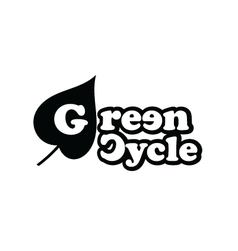
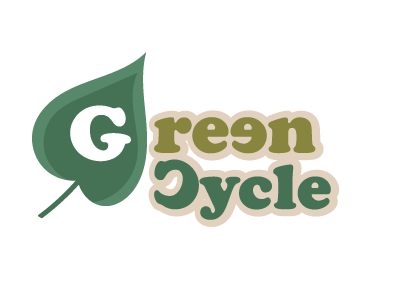

<p align="center">
  <!-- Graphic identifier for docs and GitHub -->
  
</p>

# GreenCycle

**GreenCycle** is a gamified web application where users manage a personal virtual greenhouse and a collection of digital trees.

Users can plant and view their own trees while the system progressively incorporates growth, health, time-based mechanics, harvesting, virtual currency, inventory, and a virtual shop.

---

<p align="center">
  <!-- Graphic identifier used as a visual transition -->
  
</p>

---

## 🌱 Current Scope — Sprint 2

Sprint 2 focuses on the **Laravel backend** for GreenCycle's virtual greenhouse. The application provides authentication, tree planting and retrieval, and server-side tree care with ownership checks, cooldowns, health recovery, level progression, and maturity.

The current implementation includes:

- Registration, login, and logout using Laravel Sanctum tokens.
- Protected API endpoints and access limited to each user's own trees.
- Planting trees, listing owned trees, viewing tree details, and deleting owned trees.
- Caring for an active tree using server-controlled rules:
  - One care action every **60 minutes**.
  - **+20 health**, capped at 100.
  - **+1 progress** per valid care; a level increase after **5 cares**, then progress resets to 0.
  - `MATURE` status at level **10**; `DEAD` and `MATURE` trees cannot be cared for.
- Eloquent models, migrations, factories, and relationships for users, seed types, trees, items, inventory, purchases, and active effects.
- Automated feature tests covering tree care, authorization, authentication, and data relationships.

> **Outside Sprint 2 scope:** Fetch-based frontend integration, Laravel Scheduler, automatic health deterioration, harvesting, purchasing items, applying/expiring item effects, and full virtual shop functionality. Database structures for future features do not mean their business workflows are complete.

---

## 🛠️ Technologies and Requirements

| Area | Technologies |
|---|---|
| **Backend** | PHP 8.3+ (PHP 8.5 used in CI) · Laravel 13 · Composer 2 |
| **Authentication** | Laravel Sanctum |
| **Frontend tooling** | Blade · HTML5 · CSS3 · JavaScript · Vite (Fetch integration is not required in Sprint 2) |
| **Node Environment** | Node.js 26 · npm |
| **Database** | PostgreSQL · Neon |
| **Testing** | PHPUnit · SQLite in memory |
| **Local Environment** | Laravel Herd |
| **Version Control** | Git · GitHub |
| **Code Quality** | Laravel Pint |
| **Continuous Integration** | GitHub Actions |
| **Deployment** | Render |

> Docker and a local PostgreSQL installation are not required for local development.

---

## 📁 Project Structure

Laravel is located **directly at the repository root**, not in `backend/greencycle/`.

| Directory / file | Purpose |
|---|---|
| `app/Models/` | Eloquent entities and relationships |
| `app/Http/Controllers/` | Authentication, tree management, and tree care |
| `app/Policies/` | Authorization rules |
| `database/migrations/` | Database schema |
| `database/factories/`, `database/seeders/` | Test data and initial seed types |
| `routes/api.php` | API endpoint definitions |
| `tests/Feature/` | Automated feature tests |
| `docs/` | Sprint documentation, records, and images (`docs/imgs/`) |
| `resources/`, `public/` | Frontend assets and public files |
| `.github/workflows/ci.yml` | Automated quality checks |

---

## API — Sprint 2

Authentication is handled by **Laravel Sanctum**. Only registration and login are public; all other routes require a valid authenticated session/token.

| Method | Endpoint | Purpose |
|---|---|---|
| `POST` | `/api/auth/register` | Create a user account |
| `POST` | `/api/auth/login` | Log in and obtain a token |
| `POST` | `/api/auth/logout` | Revoke the current token |
| `GET` | `/api/user` | Retrieve the authenticated user |
| `GET` | `/api/trees` | List owned trees |
| `POST` | `/api/trees` | Plant a tree using `seed_type_id` |
| `GET` | `/api/trees/{tree}` | View an owned tree |
| `DELETE` | `/api/trees/{tree}` | Delete an owned tree |
| `POST` | `/api/trees/{tree}/care` | Apply the tree care rules |

Tree-related operations check resource ownership. A care attempt on another user's tree returns **403 Forbidden**; an invalid cooldown returns **409 Conflict** with `next_care_at`. Terminal tree statuses cannot be cared for. A valid care returns the updated tree with **200 OK**.

The client cannot override internal tree properties such as `level`, `progress`, `health`, `status`, or timestamps. These values are managed on the server.

**Detailed tree API and business rules:** [`docs/sprint2-trees.md`](docs/sprint2-trees.md).

> **Model note:** The original Sprint 1 dictionary named `ACTIVE_EFFECTS.starts_at` and included an optional `status` field. The Sprint 2 implementation currently uses `started_at` and does not include that `status` column. This is a schema difference to review, not an implemented effect-expiration feature.

---

## 👥 Team & Collaboration

GreenCycle is developed collaboratively by:

- **Gabriela Calderón Benavides** — C31405
- **Denisse Ramírez Villarreal** — C06398

Both team members participate in project planning, data modeling, authentication and authorization decisions, API definition, interface development, documentation, testing, and review of each Sprint delivery.

---

## Resources & Attribution

External resources, references, libraries, and AI-assisted tools used during the project will be declared when required by the course.

The development team remains responsible for the implementation, testing, project decisions, and technical explanations.

---

## Project Status

**Sprint 2 — Backend implementation integrated in `develop`.**

The latest shared verification of `develop` reports **43 passing tests (127 assertions)** and **Laravel Pint passing across 63 files**. This verifies the currently implemented backend behavior; it does not establish that every planned future feature or frontend workflow is complete.

---

## Git Workflow

GreenCycle uses Git and GitHub for version control.

The project follows this branch workflow:

| Branch | Purpose |
|---|---|
| `main` | Stable and approved versions of the project |
| `develop` | Integration of completed Sprint work |
| `feature/*` | Development of individual features |
| `docs/*` | Documentation changes |
| `fix/*` | Corrections and bug fixes |

Sprint 2 features are integrated in `develop` through Pull Requests.

After final review, an approved Sprint version can be merged into `main` and identified by a commit, tag, or GitHub release.

---

## 📜 Development Records

Detailed Sprint documentation and development records are maintained in the `docs/` directory.

Relevant commits and development progress can be found in:

```text
docs/Commits.md
```

The complete Git history remains available directly in the GitHub repository.

---

<p align="center">
  
</p>

---

# Getting Started

The commands below are executed **from the `GreenCycle/` repository root**, where `artisan`, `composer.json`, `package.json`, and `.env.example` are located. No `backend/greencycle/` subdirectory is used.

---

# ⚙️ Installation

## 1. Clone the Repository

Open a terminal and run:

```powershell
git clone https://github.com/N1sse/GreenCycle.git
Set-Location GreenCycle
```

To work with the integrated Sprint 2 version:

```powershell
git checkout develop
git pull --ff-only origin develop
```

---

## 2. Locate the Laravel Project

The repository root already contains the application:

```text
GreenCycle/
├── artisan
├── composer.json
├── package.json
├── .env.example
├── app/
├── database/
├── routes/
└── tests/
```

All subsequent Composer, npm, Artisan, and Herd commands are run here.

---

## 3. Configure Laravel Herd

GreenCycle can be served using Laravel Herd. If your project is already inside Herd’s parked directory, linking it again may not be necessary.

If PHP 8.5 is installed through Herd, you can select it for this project:

```powershell
herd isolate 8.5
```

Register the Laravel application with Herd:

```powershell
herd link greencycle
```

GreenCycle will then be available locally at:

```text
http://greencycle.test
```

> Alternatively, serve the application with `php artisan serve` if Herd is unavailable.

---

## 4. Select the Node.js Version

GreenCycle uses Node.js 26.

The project includes a `.nvmrc` file containing the required Node.js version.

Run:

```powershell
nvm use 26
```

Verify the active version:

```powershell
node -v
```

The version should correspond to the version declared in `.nvmrc` (currently 26).

---

## 5. Install Dependencies

Install PHP dependencies:

```powershell
composer install
```

Install frontend dependencies:

```powershell
npm.cmd ci
```

> If PowerShell blocks `npm.ps1` because of the execution policy, use `npm.cmd` instead of `npm`.

---

## 6. Create the Environment File

The `.env.example` file is located at the repository root.

Create the local `.env` file from `.env.example`:

```powershell
Copy-Item .env.example .env
```

Generate the Laravel application key:

```powershell
php artisan key:generate
```

The generated `APP_KEY` is automatically stored in the local `.env` file.

> The `.env` file contains local configuration and private credentials and must never be committed to GitHub.

---

# ⚙️ Configuration

## 7. Configure the Development Database

GreenCycle uses PostgreSQL hosted on Neon.

The project separates its database environments using Neon branches:

| Environment | Database |
|---|---|
| **Development** | Neon `development` branch |
| **Production** | Neon `production` branch |
| **Automated Testing** | SQLite in memory |

When connecting to Neon, use the designated `development` database branch rather than production. For an isolated local setup, a separate SQLite database may also be configured.

Open the local `.env` file and configure the PostgreSQL credentials provided by Neon:

```env
DB_CONNECTION=pgsql
DB_HOST=NEON_HOST
DB_PORT=5432
DB_DATABASE=neondb
DB_USERNAME=NEON_USERNAME
DB_PASSWORD=NEON_PASSWORD
DB_SSLMODE=require
```

Replace `NEON_HOST`, `NEON_USERNAME`, and `NEON_PASSWORD` with the credentials provided by Neon for the `development` branch.

> Never include real Neon credentials, passwords, or connection information in the repository.

The public `.env.example` file documents the required variables without including real secrets.

---

## 8. Clear Cached Configuration

After modifying the `.env` file, clear Laravel's cached configuration:

```powershell
php artisan config:clear
```

---

## 9. Verify the Database Connection

Verify that Laravel can communicate with the configured Neon database:

```powershell
php artisan migrate:status
```

If the connection is working correctly, Laravel will display the current migration status.

---

## 10. Run Migrations and Seeders

Run pending migrations against the configured development database:

```powershell
php artisan migrate
```

If you need the sample seed types, run:

```powershell
php artisan db:seed
```

> **Destructive command:** `php artisan migrate:fresh --seed` drops all existing tables and recreates them. Use it **only on a disposable test database** after checking the active connection. Never run it against Neon production or a development database that contains data you need.

---

# ▶ Execution

## 11. Start Vite

From `GreenCycle/`, run:

```powershell
npm.cmd run dev
```

Keep this terminal open while developing GreenCycle.

---

## 12. Open GreenCycle

If the Laravel application was registered using:

```powershell
herd link greencycle
```

open the following address in the browser:

```text
http://greencycle.test
```

Laravel Herd serves the application automatically when configured.

Otherwise, you can start Laravel manually with:

```powershell
php artisan serve
```

---

## Testing and Verification

After installing and configuring GreenCycle, run the following commands from the repository root.

### Database and Migration Status

Verify that Laravel can connect to the configured database and review the current migration status:

```powershell
php artisan migrate:status
```

### Automated Tests

Run the Laravel automated test suite:

```powershell
php artisan test
```

### PHP Formatting

Check PHP formatting with Laravel Pint:

```powershell
.\vendor\bin\pint --test
```

To automatically correct formatting issues:

```powershell
.\vendor\bin\pint
```

### Frontend Build (optional for Sprint 2 review)

Although Fetch integration is outside this Sprint, frontend assets can be verified using:

```powershell
npm.cmd ci
npm.cmd run build
```

---

### Project Verification

The following results were verified on the integrated `develop` branch:

| Check | Result |
|---|---|
| `composer install` | Completed successfully |
| `php artisan migrate` | No pending migrations in the configured local environment |
| `php artisan test` | **43 passed, 127 assertions** |
| `.\vendor\bin\pint --test` | **PASS, 63 files** |
| `php artisan route:list --path=api` | **9 routes** |

**For fresh migration validation:** the Sprint 2 guide requests a clean migration run. Perform it only against a disposable database. A successful `php artisan migrate` on an existing database does not prove `migrate:fresh` has been tested.

---

## Security

The following information must never be committed or published:

- `.env`
- Real Neon database credentials
- Database connection strings
- `APP_KEY`
- GitHub tokens
- Passwords
- API keys
- Private credentials

Only `.env.example` should be included in the repository to document the environment variables required by the project.

Before committing changes, verify the repository status:

```powershell
git status
```

The local `.env` file should not appear among the files to be committed.

---

## Demo Credentials

Demo credentials will only be included if they are required and allowed for the Sprint delivery.

Personal accounts and personal credentials must never be used as demo credentials.

If demo credentials are required, provide only dedicated nonpersonal demonstration accounts.

---

<p align="center">
  <!-- Graphic identifier used to close the README -->
  
</p>

<p align="center">
  <strong>Plant. Care. Grow.</strong>
</p>
