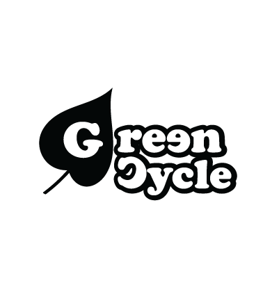
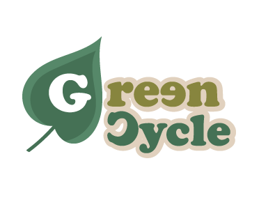

# 📜 Commit History — GreenCycle

<p align="center">
  <!-- Graphic identifier for docs and GitHub -->
  
</p>

This document records the most relevant commits made during the development of the GreenCycle project. It provides a clear and organized progress log for project tracking, team coordination, and supervisor review.

---

<p align="center">
  
</p>

## 🌱 Sprint 1

| Date | Hash | Commit message | Author |
|------|------|----------------|--------|
| 07/09/2026 | `322792d` | Initial monorepo project structure (backend, design, docs, and tests) | N1sse |
| 07/09/2026 | `0594910` | Adding `.gitkeep` to preserve folder structure | N1sse |
| 08/09/2026 | `72f30a4` | chore: configure Neon and update project structure | N1sse |
| 08/09/2026 | `e4dda66` | docs: update Sprint 1 commit history and data in README | N1sse |
| 08/09/2026 | `31accd9` | chore: add deployment and environment configuration | N1sse |
| 08/09/2026 | `573a4df` | docs: update README and commit history | N1sse |
| 08/09/2026 | `d218789` | fix: remove FrankenPHP privileged port capability | N1sse |

---

## 🌳 Sprint 2

This sprint focused on the Laravel backend: the data model, Sanctum authentication, tree management and care rules, ownership checks, cooldowns, leveling, and automated tests. The commits below follow the history shown for the `docs` branch on November 2, 2026; the order is chronological within each day.

| Date | Hash | Commit message | Author |
|------|------|----------------|--------|
| 31/10/2026 | `dffbe0b` | Reemplazo a codigo base | N1sse |
| 02/11/2026 | `a5367f6` | feat: implement tree management and care module | Gaby683 |
| 02/11/2026 | `c31172b` | test: add tree care feature tests | Gaby683 |
| 02/11/2026 | `20890ef` | test: complete tree care tests and documentation | Gaby683 |
| 02/11/2026 | `abcceea` | feat: implement seed type module | Gaby683 |
| 02/11/2026 | `70fdcba` | fix: remove unnecessary files | N1sse |
| 02/11/2026 | `19687c9` | Merge branch 'feature/database' into develop | N1sse |
| 02/11/2026 | `6deaf89` | feat: add items and inventory with data tests | N1sse |
| 02/11/2026 | `31a5308` | fix little part | N1sse |
| 02/11/2026 | `1306493` | purchases with relations and data tests | N1sse |
| 02/11/2026 | `7f570e7` | Merge pull request #1 from N1sse/feature/database | N1sse |
| 02/11/2026 | `d806b85` | Trying to add the authentication endpoints and validation tests | N1sse |
| 02/11/2026 | `5f3f366` | complete token authentication with Sanctum | N1sse |
| 02/11/2026 | `9e77999` | style: format PHP files with Laravel Pint | N1sse |
| 02/11/2026 | `495c0a2` | Merge pull request #2 from N1sse/feature/authentication | N1sse |
| 02/11/2026 | `53f96b4` | Merge branch 'develop' into feature/tree-management | N1sse |
| 02/11/2026 | `b1e4c6b` | fix: resolve tree integration and formatting issues | N1sse |
| 02/11/2026 | `6751928` | Merge pull request #3 from N1sse/feature/tree-management | N1sse |
| 02/11/2026 | `e1b27f8` | feat: add active effects model and data tests | N1sse |
| 02/11/2026 | `ff358de` | Merge pull request #4 from N1sse/feature/active-effects | N1sse |
| 02/11/2026 | `1b7bfd2` | updating README with the data/code for Sprint 2 | N1sse |
| 02/11/2026 | `e276ea2` | Merge remote-tracking branch 'origin/develop' into docs | N1sse |
| 02/11/2026 | `b83fe56` | updating the commit history for Sprint 2 | N1sse |
| 02/11/2026 | `a76be8d` | updating imgs | N1sse |
| 02/11/2026 | `041a728` | changing the name of the pics | N1sse |


### Sprint 2 verification

On the integrated Sprint 2 code, the following commands were run successfully:

```powershell
php artisan test
.\vendor\bin\pint --test
php artisan route:list --path=api
```

- **Automated tests:** 43 passed (127 assertions).
- **Laravel Pint:** passed for 63 PHP files.
- **Registered API routes:** 9.

These results document the local verification performed for the integrated backend; they do not imply that every historical commit passed its individual CI checks.

---

<p align="center">
  <strong>Plant. Care. Grow.</strong>
</p>

<p align="center">
  <!-- Closing graphic identifier -->
  
</p>
